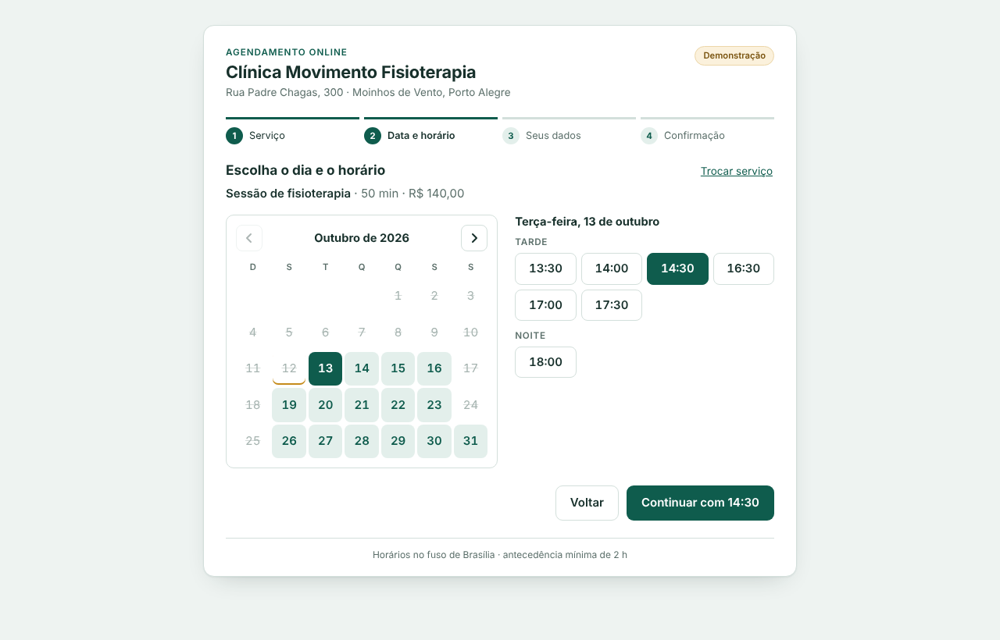

# Appointment booking widget (React)

A booking widget for clinics, salons and studios that you embed in an existing website. The
customer picks a service, a day and a free time, fills in name, phone and e-mail, and gets a
confirmation code with an "add to calendar" file. Free times are computed from the opening hours,
the length of the service and the appointments already on the books, so double bookings cannot
happen.




## Features

- **Four short steps:** service → day and time → customer details → confirmation, with a progress
  bar and a "first available day" shortcut.
- **Real availability rules:** opening intervals per weekday (lunch breaks included), slot step,
  minimum notice (2 hours), booking window (45 days), holidays and the duration of each service.
  The rules are pure functions in `src/slots.ts` with unit tests.
- **Form validation in Portuguese:** full name, Brazilian phone mask while typing
  (`(51) 99876-5432` or `(51) 3333-4444`), e-mail; errors are linked to their fields and focus moves
  to the first invalid one.
- **Race-safe booking:** if somebody takes the time while the customer is typing, the API answers
  409 and the widget goes back to the calendar with a clear message.
- **Confirmation:** booking code, summary and a downloadable `.ics` file. Inside an iframe the
  widget also sends `postMessage({ type: "booking:confirmed", code, serviceId, date, start })` to
  the host page (no personal data), so the site can close a modal or record a conversion.
- **Demo or real data:** a deterministic demo agenda out of the box; set `VITE_API_URL` to use your
  own backend.
- Keyboard accessible (arrow keys move through the calendar, focus follows each step), responsive
  down to 390 px, respects reduced motion.

## How to use

Requirements: Node.js 20 or newer (22 recommended).

```bash
npm ci
npm run dev          # http://localhost:5173 with the demo agenda
npm test             # 26 tests (availability rules, masks, API client, booking flow)
npm run typecheck
npm run build        # static files in dist/
npm run preview      # serves dist/ on http://localhost:4173
```

Docker (Nginx serving the static build):

```bash
docker build -t booking-widget .
docker run --rm -p 8080:80 booking-widget        # http://localhost:8080
```

### Connecting your own backend

Create `.env.local` (or pass `--build-arg VITE_API_URL=...` to `docker build`):

```bash
VITE_API_URL=https://agenda.example.com.br/api
```

The widget expects three endpoints:

| Method | Path | Returns |
| --- | --- | --- |
| GET | `/services` | `[{ id, name, description, durationMin, priceCents }]` |
| GET | `/availability?from=YYYY-MM-DD&to=YYYY-MM-DD` | appointments already booked: `[{ date, start: "HH:MM", durationMin }]` |
| POST | `/bookings` | body `{ serviceId, date, start, customer }`; answers the confirmation `{ code, ... }`, or 409 if the time was taken |

The backend must check availability again on `POST /bookings`; the widget only prevents mistakes
in the browser. Opening hours, notice, booking window and holidays live in `src/config.ts`.

### Embedding in a website

Host the build (any static host, S3/CloudFront, Nginx) and add an iframe to the page:

```html
<iframe src="https://agenda.example.com.br/" title="Agendamento online"
        style="width:100%;max-width:780px;height:820px;border:0"></iframe>
```

```js
window.addEventListener("message", (e) => {
  if (e.origin === "https://agenda.example.com.br" && e.data?.type === "booking:confirmed") {
    console.log("Booked", e.data.code);
  }
});
```

**Stack:** React 18, TypeScript, Vite 5, Vitest, Testing Library. No date or form library
(about 53 kB gzipped in total).

## Em português

Widget de agendamento online para clínicas, salões e estúdios, feito para ser incorporado ao site
da empresa (iframe). O cliente escolhe o serviço, o dia e um horário livre, informa nome, celular
(com máscara brasileira) e e-mail, e recebe um código de confirmação e um arquivo para adicionar à
agenda. Os horários livres são calculados a partir do horário de funcionamento (com intervalo de
almoço), da duração de cada serviço, da antecedência mínima, dos feriados e dos agendamentos já
existentes.

Como usar: `npm ci` e `npm run dev` abrem o widget com uma agenda de demonstração em
http://localhost:5173; `npm test` roda os testes e `npm run build` gera os arquivos estáticos em
`dist/`. Para usar a sua agenda real, defina `VITE_API_URL` no `.env.local` (ou
`--build-arg VITE_API_URL=...` no `docker build`) apontando para uma API com os três endpoints da
tabela acima. Horários, feriados e antecedência ficam em `src/config.ts`. Funciona no celular e só
com teclado.
