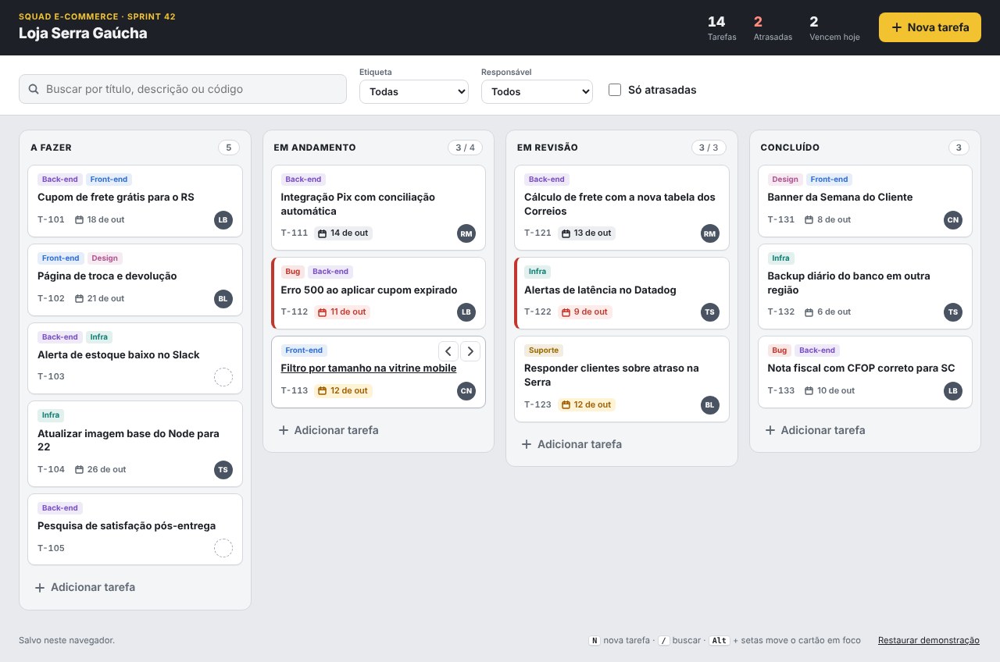
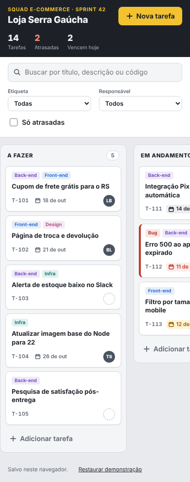

# Team task board (React)

A kanban board for a small product team: tasks move from "to do" to "done" by drag and drop or
from the keyboard, with labels, owners, due dates and filters. The board is saved in the browser,
so it works as a personal or team-room board without a backend.





## Features

- **Four columns with WIP limits:** "Em andamento" and "Em revisão" show `3 / 4` and turn amber
  when the limit is exceeded.
- **Drag and drop** with [@dnd-kit](https://dndkit.com/) (mouse and touch): drop on a column to
  append, or on a card to take its place.
- **Keyboard alternative:** every card has "previous / next column" buttons; with a card focused,
  `Alt + ←/→` moves it between columns and `Alt + ↑/↓` changes its order. Focus stays on the card
  and each move is announced to screen readers. `N` creates a task and `/` jumps to search.
- **Create and edit** in a dialog (title, description, column, owner, due date, labels), with
  validation, focus trap, `Escape` to close and a two-step delete.
- **Due dates:** overdue cards get a red edge and chip, cards due today an amber chip; finished
  cards are never flagged. The header counts tasks, overdue and due today.
- **Filters:** text search (accent-insensitive, also by code such as `T-112`), label, owner
  (including "no owner") and "overdue only".
- **Saved in localStorage** with every access wrapped in `try/catch`: corrupted data is ignored,
  and if storage is blocked (private mode, sandboxed iframe) the board keeps working in memory
  and says so in the footer.
- Responsive down to 390 px (columns scroll sideways with snap), respects reduced motion.

## How to use

Requirements: Node.js 20 or newer (22 recommended).

```bash
npm ci
npm run dev          # http://localhost:5173 with the demo board
npm test             # 22 tests (board logic, persistence, UI flows)
npm run typecheck
npm run build        # static files in dist/
npm run preview      # serves dist/ on http://localhost:4173
```

Docker (Nginx serving the static build):

```bash
docker build -t kanban-board .
docker run --rm -p 8080:80 kanban-board         # http://localhost:8080
```

No environment variables are needed. Columns, labels and people are in `src/data.ts`; the board is
stored under the `kanban-board:v1` key, and "Restaurar demonstração" in the footer brings the demo
data back.

**Stack:** React 18, TypeScript, Vite 5, @dnd-kit/core, Vitest, Testing Library (about 67 kB
gzipped in total).

## Em português

Quadro kanban para equipes pequenas: as tarefas passam de "A fazer" para "Concluído" arrastando
com o mouse ou o dedo, ou pelo teclado (botões de mover em cada cartão e `Alt` + setas). Cada
tarefa tem etiquetas, responsável e prazo; as atrasadas ficam destacadas em vermelho. Há busca,
filtros por etiqueta, responsável e "só atrasadas", e limite de tarefas em andamento por coluna.
Tudo fica salvo no navegador (localStorage), sem precisar de servidor.

Como usar: `npm ci` e `npm run dev` abrem o quadro com dados de demonstração em
http://localhost:5173; `npm test` roda os testes e `npm run build` gera os arquivos estáticos em
`dist/` (ou use o `docker build` acima). Atalhos: `N` cria uma tarefa, `/` vai para a busca. Colunas,
etiquetas e pessoas ficam em `src/data.ts`.
