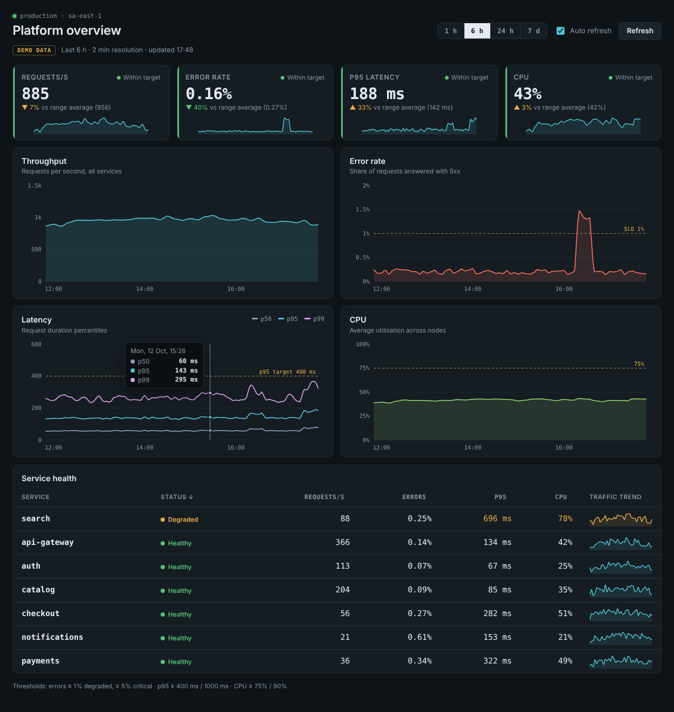
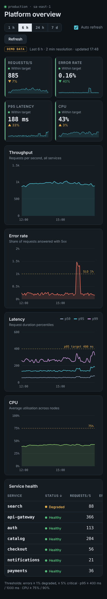

# Infrastructure metrics dashboard (React)

A one-screen view of a production platform for the on-call engineer: traffic, errors, latency and
CPU for the chosen time range, and a service table that puts the unhealthy services on top. It
runs on deterministic demo data out of the box, or reads straight from a Prometheus server.





## Features

- **Time ranges:** 1 h, 6 h, 24 h and 7 d, with a resolution that fits each (30 s to 1 h). The
  range is kept in the URL (`?range=24h`), and the data refreshes every 30 seconds.
- **KPI tiles:** requests/s, error rate, p95 latency and CPU, each with a status against its
  target, the change versus the range average and a sparkline.
- **Charts drawn by hand in SVG** (no chart library): throughput and CPU areas, error rate with the
  SLO line, p50/p95/p99 latency with the target line. Hover, or focus a chart and use the arrow
  keys (Shift for bigger steps, Home/End, Escape), to read exact values. Gaps in the data are
  drawn as gaps, not as zeros.
- **Service health table:** requests/s, errors, p95 and CPU per service, coloured by threshold,
  sortable by any column, with a traffic sparkline. The worst status comes first.
- **Demo data that tells a story:** daily traffic in Brasília time, a payments outage about an hour
  and a half ago and a search slowdown right now. Values are a function of the timestamp, so every
  range agrees and tests are stable.
- **Prometheus:** set `VITE_PROMETHEUS_URL` and the dashboard calls `/api/v1/query_range` (ten
  queries in parallel). Errors are shown with a hint and a "Show demo data" button.
- Thresholds live in one file (`src/thresholds.ts`). Keyboard accessible, responsive down to
  390 px.

## How to use

Requirements: Node.js 20 or newer (22 recommended).

```bash
npm ci
npm run dev          # http://localhost:5173 with demo data
npm test             # 23 tests (paths and scales, demo data, Prometheus client, UI)
npm run typecheck
npm run build        # static files in dist/
npm run preview      # serves dist/ on http://localhost:4173
```

Docker (Nginx serving the static build):

```bash
docker build -t metrics-dashboard .
docker run --rm -p 8080:80 metrics-dashboard    # http://localhost:8080

# with Prometheus
docker build --build-arg VITE_PROMETHEUS_URL=https://prometheus.example.com -t metrics-dashboard .
```

### Connecting Prometheus

Create `.env.local`:

```bash
VITE_PROMETHEUS_URL=https://prometheus.example.com
```

The default PromQL in `src/queries.ts` expects `http_requests_total` (with `status` and `service`
labels), the `http_request_duration_seconds` histogram, `node_cpu_seconds_total` and
`process_cpu_seconds_total`; change the queries to match your metrics. The browser calls
Prometheus directly, so either serve the dashboard and Prometheus behind the same reverse proxy or
allow the dashboard origin with CORS (`--web.cors.origin`). Prometheus has no login of its own:
keep both on an internal network or behind your SSO proxy.

**Stack:** React 18, TypeScript, Vite 5, Vitest, Testing Library. Charts are hand-drawn SVG
(about 52 kB gzipped in total).

## Em português

Painel de métricas de infraestrutura para quem está de plantão: requisições por segundo, taxa de
erro, latência p95 e CPU no período escolhido (1 h, 6 h, 24 h ou 7 dias), gráficos desenhados à mão
em SVG com linhas de meta (SLO) e uma tabela de saúde dos serviços com minigráficos, ordenada
pelos piores primeiro. Vem com dados de demonstração determinísticos (com um incidente em
pagamentos e uma lentidão na busca) e pode ler direto de um Prometheus.

Como usar: `npm ci` e `npm run dev` abrem o painel em http://localhost:5173; `npm test` roda os
testes e `npm run build` gera os arquivos estáticos em `dist/` (ou use o `docker build` acima).
Para dados reais, defina `VITE_PROMETHEUS_URL` no `.env.local` (ou `--build-arg` no Docker) e
ajuste as consultas PromQL em `src/queries.ts`. Os gráficos podem ser lidos pelo teclado (setas)
e o painel funciona no celular.
