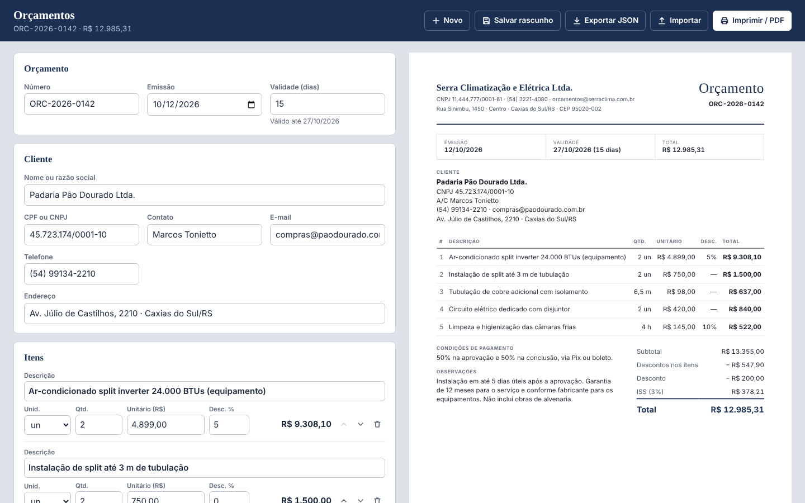
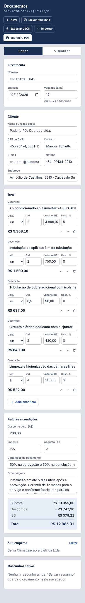

# Quote builder (React)

A quote (orçamento) builder for service companies: fill in the client, the line items and the
conditions, and the A4 document on the right updates as you type. Print it or save it as PDF from
the browser, keep drafts in the browser and export or import them as JSON.





## Features

- **Client and company data** with a CPF/CNPJ mask and check-digit validation.
- **Line items:** description, unit, quantity (decimals such as `6,5 m`), unit price and a
  percentage discount per line; add, remove and reorder items with buttons.
- **Totals in reais:** subtotal, line discounts, a global discount, a tax line (ISS by default)
  and the grand total. Money is kept in integer cents and rounded once per line, so the preview
  and the totals always agree. Inputs accept `1.234,56`, `1234,56` or `1234.56`.
- **Validity:** issue date + days, shown as a date on the document.
- **Live A4 preview** with print CSS (`@page size: A4`): only the document is printed, so
  "Imprimir / PDF" gives a clean one-page PDF. Printing is blocked with a list of problems when
  the client name or the items are missing.
- **Drafts** saved in localStorage (wrapped in `try/catch`; if storage is blocked the app says so
  and suggests exporting), numbered `ORC-2026-0143`, `ORC-2026-0144`...
- **Export / import JSON**, validated on import.
- Keyboard accessible, responsive down to 390 px (an "Editar / Visualizar" switch on small
  screens).

## How to use

Requirements: Node.js 20 or newer (22 recommended).

```bash
npm ci
npm run dev          # http://localhost:5173 with a demo quote
npm test             # 22 tests (money, totals, CPF/CNPJ, drafts, UI flows)
npm run typecheck
npm run build        # static files in dist/
npm run preview      # serves dist/ on http://localhost:4173
```

Docker (Nginx serving the static build):

```bash
docker build -t quote-generator .
docker run --rm -p 8080:80 quote-generator      # http://localhost:8080
```

No environment variables are needed: everything runs in the browser. To print or create a PDF,
click "Imprimir / PDF" and choose "Save as PDF" in the print dialog (A4, no margins needed). The
default company data and units are in `src/data.ts`.

**Stack:** React 18, TypeScript, Vite 5, Vitest, Testing Library. No PDF or form library
(about 54 kB gzipped in total).

## Em português

Gerador de orçamentos para empresas de serviço: dados do cliente (com validação de CPF/CNPJ),
itens com quantidade, valor unitário e desconto, desconto geral, imposto (ISS) e total em reais,
validade e condições de pagamento. A folha A4 ao lado é atualizada enquanto você digita e pode
ser impressa ou salva em PDF direto pelo navegador. Os rascunhos ficam salvos no navegador e o
orçamento pode ser exportado e importado em JSON.

Como usar: `npm ci` e `npm run dev` abrem o gerador com um orçamento de exemplo em
http://localhost:5173; `npm test` roda os testes e `npm run build` gera os arquivos estáticos em
`dist/` (ou use o `docker build` acima). Para gerar o PDF, clique em "Imprimir / PDF" e escolha
"Salvar como PDF". Os dados padrão da empresa ficam em `src/data.ts`.
