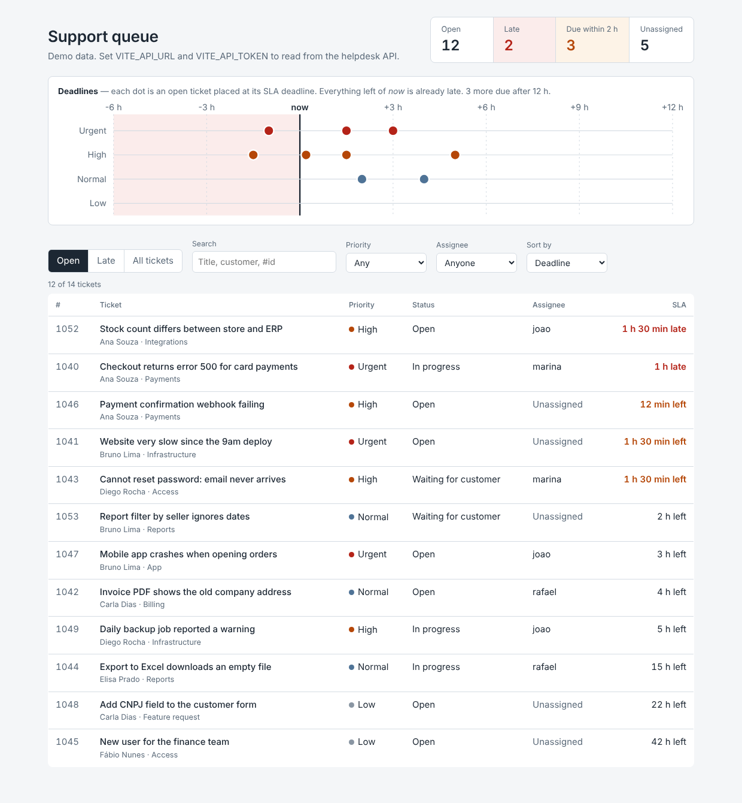

# Support queue dashboard (React)

A dashboard for the person running a support team: what is late, what is about to be late, and
who is on it. Open tickets are placed on a deadline timeline, so the queue reads at a glance before
you dig into the table.



## Features

- **Deadline timeline:** each open ticket sits at its SLA deadline relative to now, in one lane per
  priority; the late zone is shaded. Click or press Enter on a dot to highlight the ticket.
- **Queue summary:** open, late, due within 2 hours and unassigned.
- **Filters and sorting:** open / late / all, text search, priority, assignee; sort by deadline,
  priority or creation date. Times refresh every 30 seconds.
- **Data:** demo data out of the box, or live from the
  [django-helpdesk](https://github.com/GonService/python-projects/tree/main/django-helpdesk) API with
  `VITE_API_URL` and `VITE_API_TOKEN` in `.env.local` (follows pagination). The token is embedded
  in the built files, so only deploy that build on an internal network or behind a login
  (an authenticating proxy or SSO); never publish it on the open internet.
- Keyboard accessible, responsive down to phone width, respects reduced motion.

## Run

```bash
npm ci
npm run dev        # http://localhost:5173
npm test           # 11 tests (logic + UI with Testing Library)
npm run build      # static files in dist/, deployable to S3/CloudFront, Netlify or Nginx
```

Docker: `docker build -t support-dashboard . && docker run -p 8080:80 support-dashboard`.

The static build can be published with
[terraform-aws-static-site](https://github.com/GonService/terraform-aws-static-site).

**Stack:** React 18, TypeScript, Vite 5, Vitest, Testing Library. No chart library: the timeline is
hand-drawn SVG (about 50 kB gzipped in total).

## Em português

Painel para quem coordena o suporte: mostra o que está atrasado, o que vai atrasar e quem está
cuidando. Os chamados abertos aparecem numa linha do tempo pelo prazo de SLA, com filtros, busca e
dados ao vivo da API do helpdesk em Django. Funciona no celular e só com teclado.
